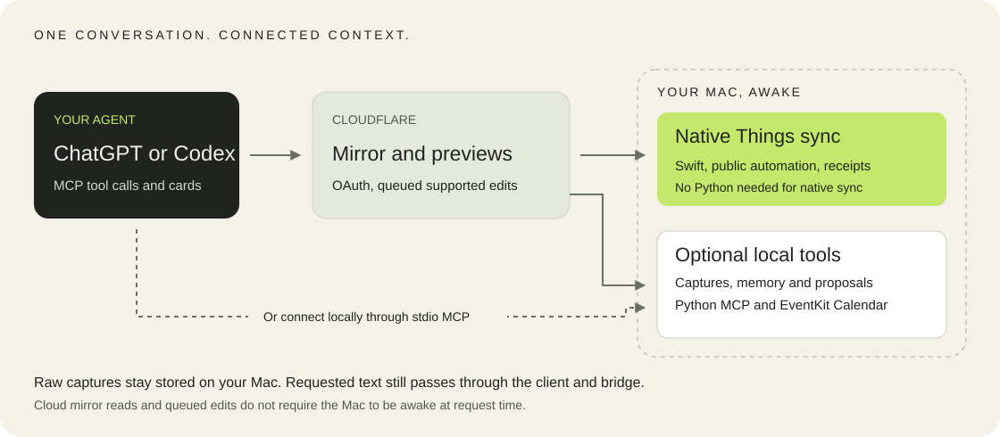

<p align="center">
  
</p>

# LifeOS

Your thoughts, tasks and calendar, connected through the agent you already use.

<p>
  <a href="LICENSE"></a>
  
  
  
</p>

[What it does](#what-it-does) · [Architecture](#how-it-fits-together) · [Get started](#get-started) · [Privacy](#your-data-and-your-approval) · [Documentation](#documentation)

LifeOS connects Things 3 and Apple Calendar to MCP clients such as ChatGPT and Codex. Talk through a brain dump, review a visual plan, then approve the exact changes you want. Your Mac keeps the original words and the saved decisions, so the next chat does not have to start from scratch.

Things stays your task manager. Calendar stays your calendar. [Anytype](docs/anytype.md) holds your notes and daily journal. LifeOS handles the coordination between them.

> Personal, Mac-first software in active development. This repository includes local MCP tools, interactive ChatGPT cards and a native cloud-sync companion. It is not a packaged, one-click app release.

## What it does

| Start with | LifeOS gives you |
| --- | --- |
| A brain dump | Original text saved locally, plus a separate interpretation with tasks, journal prose, questions and source excerpts. |
| A meeting transcript and notes | A canvas for reviewing candidate actions and their evidence, without overwriting the original text. |
| An overloaded day or week | A plan preview built around Calendar availability, with draggable blocks and duration editing. |
| A proposed change | A review card bound to an exact revision, followed by approval, source checks and application receipts. |
| Something you said last week | Searchable captures and optional memory recall that do not depend on the originating chat. |
| Something in your notes | Search, read and add Anytype notes, with object ids to cite. Captures and interpretations land in Anytype too. Ask from Anytype's own chat named LifeOS. |
| A Things edit while your Mac is asleep | A queued title, completion or recoverable Trash operation for the native agent to process when your Mac is awake. |

### Ask in your own words

These are example requests, not commands that bypass review. Your client needs the relevant tools and permissions.

> "Here's everything on my mind. Save the raw text first, then show me the tasks, questions and journal notes."

> "I just had a meeting. Compare the transcript with the notes. Find actions assigned to me and show the supporting quotes."

> "Plan the next three days around my calendar. Show the blocks before changing anything."

> "What did I say about this project last week? Show me the source, not just a memory summary."

### Review it visually

LifeOS supplies MCP Apps components for day plans, week plans, brain-dump canvases, proposal reviews and memory reviews.

Planner cards support moving blocks and resizing their duration. The brain-dump canvas can show task, Calendar and journal previews, questions and Mermaid relationships. Proposal cards keep approval tied to the revision you reviewed.

Rendering a card does not write to Things or Calendar. ChatGPT must load its registered UI resource to display it. A successful tool response alone does not prove the card rendered.

See the [ChatGPT UI guide](docs/chatgpt-ui.md) and [multi-day planner guide](docs/week-plan-ui.md).

## How it fits together



| Component | Responsibility |
| --- | --- |
| [Local MCP service](src/lifeos) | Python 3.14 and FastMCP. Captures, planning, proposals, memory integration and UI resources. |
| [Native Mac agent](mac-sync/README.md) | Swift menu-bar app. Supported Things automation, event-driven sync, Keychain credentials and durable receipts. Native Things sync needs neither Python nor the 1Password CLI. |
| [Cloudflare companion](cloud-mirror/cloudflare/README.md) | OAuth-protected MCP, a Things mirror, queued supported edits and transient calls to the enabled Mac bridge. |
| [Calendar helper](eventkit-bridge/README.md) | Native EventKit access for Calendar reads and approved event changes. |
| [Local memory](docs/research/supermemory-local-models-2026-09.md) | Optional Supermemory integration with local embeddings, explicit indexing and a configured remote extraction model. |

Cloud mirror reads and supported queued edits can work while the Mac is asleep. Capture, Calendar, local memory, planning and proposal application through the unified connector need an awake Mac and an enabled, authorised bridge.

The bridge starts an allowlisted Python subprocess for a tool call. It does not run an idle model or automatically replay a timed-out call.

## Your data and your approval

### Preserve the words before interpreting them

Raw brain dumps and transcripts live in local SQLite. Interpretations are separate immutable revisions linked to those captures. Reprocessing does not overwrite the original text. A copy of each capture, its interpretations and your journal prose also land in your LifeOS space in Anytype; the Anytype journal day is the journal, and Markdown is an export ([ADR 0003](docs/adr/0003-anytype-is-the-notebook.md)).

Local storage does not mean the text never leaves your Mac. ChatGPT receives the content it sends or requests. Bridge traffic passes through Cloudflare in memory, without saving raw captures to its durable queue or D1. Explicit memory indexing sends content to the configured extraction provider.

### Approve an exact proposal

Simple tasks you explicitly ask to add can use `create_requested_task` in one call.
It creates one Things to-do, defaults to Personal, verifies the write and returns
an immutable audit record and receipt. It does not need a LifeOS review card or
a second approval message. Reuse its `request_id` unchanged after a timeout.
An uncertain or failed write is not automatically replayed. Relative dates must
be resolved to your local `YYYY-MM-DD` date before calling the tool.
Timing constraints such as "after 8pm" belong in notes. This tool does not set
or verify a timed alarm, create a Calendar block or invent a duration.

This exception is for explicit single-task requests, not inferred meeting actions,
batches, existing-item edits or Calendar changes. OAuth write access and platform
permission prompts still apply. The unified cloud connector needs an awake Mac
with local tools enabled.

The local proposal flow is:

```text
Read sources → Prepare proposal → Review revision → Approve exact hash
                                                        ↓
Record receipts ← Apply and verify ← Recheck source snapshots
```

Only you approve. The review card calls approval for you; the model cannot see the approve and reject tools. If a host shows no card, run `uv run lifeos approve <proposal_id> <revision_hash>` in a terminal.

LifeOS checks for stale sources before applying a proposal. Application records per-operation receipts. Check saved state before retrying an interrupted call, because a timeout is not proof that nothing happened.

Cloud-queued Things edits use a separate field-revision and receipt workflow. They do not bypass their OAuth permissions or native read-back checks.

Things notes, Calendar descriptions, transcripts and retrieved memories are source material, not instructions for the agent. Memories are suggestions to check against their evidence.

### Keep the limits visible

The native sync agent uses supported Things automation and never reads its private database. The retained Python adapter uses `things-py` for local reads. Its writes use the official Things URL scheme, not direct database edits.

Calendar updates and deletions are restricted to events carrying the LifeOS ownership marker. macOS still controls Things automation and Calendar permissions.

## Get started

The local MCP service needs macOS 13 or newer, Things 3, Python 3.14, `uv` and Swift. The native sync package targets macOS 14 or newer and requires Swift 6.3 to build.

From the repository root:

```sh
uv sync --extra test
swift build -c release --package-path eventkit-bridge
uv run lifeos-mcp
```

The last command starts the stdio MCP server. Configure your client to launch it from your checkout. For example:

```toml
[mcp_servers.lifeos]
command = "uv"
args = ["--directory", "/absolute/path/to/lifeos", "run", "lifeos-mcp"]
```

Replace the checkout path with your own. Calendar use may require macOS permission for the host process.

For a local HTTP server on an uncommon port:

```sh
uv run lifeos-mcp --transport streamable-http --host 127.0.0.1 --port 48763
```

Do not expose an unauthenticated local listener to the internet. Use the [runtime and OAuth guide](docs/runtime.md) for configuration.

For ChatGPT website integration, follow the [unified connector guide](docs/unified-connector.md). Local stdio configuration does not connect ChatGPT.com to your Mac. Refresh connector tools after changes, then verify a real call and card in the host.

For the native companion, follow the [Mac sync build and activation guide](mac-sync/README.md). Preserve existing credentials and journals during upgrades. The provisioning script is not an update command.

<details>
<summary>Local storage and installed services</summary>

The local service accepts these storage overrides:

| Variable | Default |
| --- | --- |
| `LIFEOS_DB_PATH` | `~/Library/Application Support/LifeOS/lifeos.sqlite3` |
| `LIFEOS_JOURNAL_DIR` | `~/Library/Application Support/LifeOS/Journal` |
| `LIFEOS_CALENDAR_HELPER` | The EventKit release helper in this checkout. |
| `LIFEOS_ANYTYPE_CONFIG` | `anytype.json` next to the database (base URL, space, chat), written by `lifeos anytype connect`. |
| `LIFEOS_ANYTYPE_URL`, `LIFEOS_ANYTYPE_SPACE_ID` | Override the saved Anytype base URL and space. |
| `LIFEOS_ANYTYPE_API_KEY_FILE` | A 0600 file with the Anytype API key, instead of the macOS Keychain. |

On the owner's configured Mac, `lifeos-stack start`, `lifeos-stack status` and `lifeos-stack stop` control the installed MCP, ngrok and memory launch agents. `lifeos-stack reload` restarts only MCP. This helper uses owner-specific paths. It is not a portable installer or a control for the native menu-bar app.

The memory scripts keep the extraction key in macOS Keychain. Their Supermemory startup checks require the macOS firewall to block incoming connections to the memory binary. See the [memory integration notes](docs/research/supermemory-local-models-2026-09.md).

</details>

## Verify changes

```sh
sh scripts/verify.sh
```

The local pipeline runs lint, tests, schema drift checks and a synthetic capture through an isolated HTTP MCP server. It uses a disposable SQLite store and does not apply a real proposal.

Cloud and native components have separate suites. See the [project verification skill](.agents/skills/verify/SKILL.md), [Cloudflare guide](cloud-mirror/cloudflare/README.md) and [native sync guide](mac-sync/README.md).

A passing build or health check does not prove ChatGPT rendered a card, a real write completed, or an iPhone received a change. Verify those paths separately.

## Documentation

| Looking for | Read |
| --- | --- |
| Local runtime, configuration and OAuth | [Runtime guide](docs/runtime.md) |
| One ChatGPT connection with an optional Mac bridge | [Unified connector](docs/unified-connector.md) |
| Capture storage and interpretation revisions | [Brain dumps](docs/brain-dumps.md) |
| UI resource bindings and host behaviour | [ChatGPT UI](docs/chatgpt-ui.md) |
| Native sync, signing and owner activation | [Mac companion](mac-sync/README.md) |
| Event-driven sync and conflict handling | [Smart-sync design](docs/smart-merge-design.md) |
| Memory options and extraction trade-offs | [Memory research](docs/research/memory-systems-2026-09.md) |
| Notes in Anytype: tools, tiers, chat agent and safety | [Anytype notes](docs/anytype.md) |
| Setting up Anytype, the chat agent, ChatGPT and claude.ai | [Rollout checklist](docs/anytype-rollout.md) |
| Colours, artwork and reusable mark | [Brand guide](docs/brand.md) |

## Direction

LifeOS started with one person's workload across work, university and personal projects. The goal is to reduce what you need to keep in your head, while letting you inspect how a thought became a task or a block of time.

The standalone macOS canvas is a future direction, not a shipped app. Today the interactive planning UI lives in MCP Apps cards, alongside the native sync companion.

Built by Avi. [MIT licensed](LICENSE).

## Explicit task CRUD

For a single task the user explicitly requests, the connected Mac supports
`create_requested_task`, `read_requested_task`, `update_requested_task` and
`trash_requested_task`. These do not require an extra LifeOS review card.
Edits and Trash require an exact local task ID and its fresh `source_hash`.
Use local search or read-by-ID if the cloud mirror has not caught up.
Deletion moves the task to recoverable Things Trash, never permanent deletion.
Writes retain immutable intent and verified receipts. Retry with the same request
ID and arguments; do not automatically replay an uncertain write.
ChatGPT and macOS permissions still apply. Inferred changes, batches and Calendar
changes continue through reviewed proposals.
