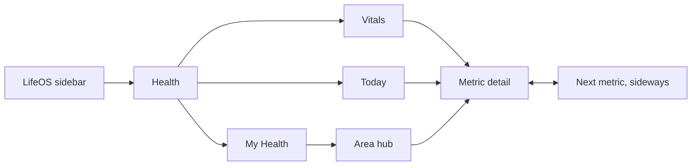

# If Oura made a Mac app: LifeOS Health design brief

Research date: 11 October 2026 (Melbourne). Research only. No application code was changed.

Companion notes: [oura-gallery-notes-2026-10-11.md](oura-gallery-notes-2026-10-11.md) (App Store screenshots and design gallery survey).

## 1. The short answer

Oura's app is built on three layers. LifeOS Health should use the same three layers:

| Layer | Oura tab | Question it answers | Feel |
| --- | --- | --- | --- |
| Now | **Today** | "What matters for me right now?" | One big story, photo hero, calm words |
| Measurements | **Vitals** | "What are my numbers on this date?" | Stable grid, same place every day |
| Long term | **My Health** | "Am I trending well over months?" | Slow, reflective, one arc for all areas |

Oura feels good for four reasons, and these matter more than the colours:

1. **One headline at a time.** Today leads with a single number, a short serif sentence and one button. The rest waits below.
2. **Words before numbers.** Every card has a status word (Optimal, Good, Aligned, Looking Good) in colour, so you can read it without knowing the scale.
3. **Everything is a doorway.** Each card has a chevron and opens a detail screen. Detail screens let you move sideways to the next metric without going back.
4. **Personal, not generic.** Oura says insights move from population averages to your own baseline over time. Text explains what changed compared with *you*.

## 2. Evidence levels

| Level | Meaning | Sources |
| --- | --- | --- |
| A. Verified Oura behaviour | Oura says it in current official text | Oura support "How to Use the Oura App", updated 7 Oct 2026. Oura blog 3 Oct 2024 and 5 Nov 2025 |
| B. Observed production UI | Real Oura screenshots were viewed | Three images in the support article (viewed). Seven App Store screenshots, v7.26.0 (viewed by research agent) |
| C. Proposed desktop design | Recommendation. Oura has no Mac app | Sections 5 to 7 and 10 |
| D. Data availability | What Google's API lists for Fitbit Air | Google Health data types page, fetched 11 Oct 2026 |

Gaps: Mobbin images are login gated, Refero needs a full browser, Page Flows and UI Sources have no Oura content. No source documents Oura's animation timings, exact fonts or colour values. Anything below about motion is a proposal.

## 3. Verified current Oura structure (level A)

### Today

- Content changes through the day based on timing and relevance.
- Top row of shortcuts: Readiness, Sleep, Activity, Cycle day or Pregnancy, Heart rate, Stress, Glucose. Swipe left and choose Customize to reorder. Minimum of three.
- Below: important updates and insights, action items (naps, updates, automatic activity detection), a timeline of recent events, and "What's new".

### Vitals

- The stable home for all key metrics, grouped: Readiness, Sleep, Activity, Stress, Women's health, Heart health, Metabolic health, and core metrics (resting heart rate, HRV, temperature, respiratory rate).
- Tap a card for detail or trend. Change date by swiping or using the top calendar.
- Missing data means the ring wasn't worn or there wasn't enough data.
- Pencil (top right) lets you drag categories into a new order, then Done.
- Opt-in features only appear for enrolled users.

### My Health

- Health Areas arc at the top, with 90-day trend lines from each icon.
- Four ratings: Thriving (blue), Looking Good (green), Worth Watching (yellow), Needs Care (red).
- Tap an area for its hub: rating, key metrics, related metrics.
- Baselines need 2 to 4 weeks of use. A calibration message shows until then.
- Habits and routines cards show rolling 30-day averages and lead into Trends.

### Menus

- **+ button:** Advisor, log period, unguided session, log meal, add tag, add activity, record workout heart rate.
- **Top-left menu:** profile, devices, settings, Trends, Reports, Meals, Integrations, Rest Mode and more.
- **Top-right device icon:** battery, firmware, serial, device actions.

## 4. Observed visual language (level B)

From the three official support screenshots and the App Store images:

- **Today hero:** full-bleed photo (snowy mountain for Readiness, green hills for Steps). Thin white arc gauge from 0 to 100 with dot ticks. Big light sans number, small caps label, large serif headline ("Go get 'em!"), short centred paragraph, dark pill "Learn more" button. The next card peeks in at the bottom.
- **Score chips:** circles with a hairline border, small icon above the number, label below. The row scrolls sideways.
- **Vitals cards:** near-black background, dark rounded cards in a two-column grid, section headers with thin line icons. Card title top left with a chevron, coloured status word under it, big number bottom left. Some cards use a small illustration instead of a number (Symptom Radar dome, Body Clock arcs).
- **My Health:** layered curved lines in a gradient from warm (Needs Care) to cool blue (Thriving), floating round icons on the lines, serif headline summarising the trend, "Dive in with Advisor" pill, then area cards with a soft tinted glow.
- **Detail screens:** the tab bar becomes an icon row for switching metrics. Sleep detail has period tabs, a hypnogram in shades of blue, a movement strip and a stage legend with durations and percentages. Daytime Stress has a banded line chart and overlay toggles.
- **Type:** serif for headlines and stories, clean sans for labels and numbers, small caps with tracking for eyebrows and status words.
- **Colour:** dark mode first. Each metric has a glow colour (teal for sleep, purple for stress, blue for heart). Colour carries meaning.

## 5. Proposed Mac shell (level C)

Keep the three layers and the calm, and use Mac conventions for navigation.

- **LifeOS global sidebar stays.** Health is one item. Inside Health, put **Today / Vitals / My Health** as a segmented control in the window toolbar. This replaces the iPhone floating tab bar.
- **+ becomes a toolbar button and a menu bar menu** (New Tag, New Activity, Note). Only include actions LifeOS actually supports.
- **The hamburger menu becomes the sidebar and the Settings window.** Device and source details live in Settings > Sources. Ring controls (Rest Mode, SpO₂ toggle, airplane mode) are dropped.
- **Content column:** centre content at about 720 to 960 pt wide. Wide windows add an optional right inspector (definitions, source, "how this is calculated") instead of stretching cards.
- **Vitals grid:** two columns at narrow widths, three or four at wide widths. Keep Oura's card anatomy.
- **Detail screens:** push within Health with a native back button (Cmd+[ and the toolbar chevron). A metric switcher row of icons sits under the toolbar, as on iPhone. Left and right arrow keys move between metrics when the switcher has focus.
- **Date navigation:** the Yesterday / Today strip with a calendar icon stays. Add Cmd+Left / Cmd+Right for previous and next day (proposed, check against existing LifeOS shortcuts).

### Continuity rules (the biggest part of "feel")

- Going back restores scroll position, selected date and chart selection.
- The selected date carries across Vitals and detail screens.
- Reordered shortcuts and categories persist between launches.
- Esc closes popovers and sheets. It doesn't leave a detail screen.

## 6. Proposed screens

### Today

1. Shortcut chips row (Sleep, Activity, Heart rate, HRV, plus any LifeOS score built later). Click opens the detail. Right-click > Customize opens a reorder sheet.
2. Hero: photo background, arc gauge, big number, serif sentence, one button. Keep it to about 45 to 55% of window height so the first card peeks below. That peek tells you to scroll.
3. Action cards, for example "Workout detected, Confirm / Edit", only when real data exists.
4. Timeline: today's sleep, workouts and tags in time order.

### Vitals

Grouped cards for metrics LifeOS actually has. Status words come from plain rules against your own history (section 8).

### Metric detail (one template for every metric)

1. Headline value and status word.
2. Story sentence in serif, written from data ("42 minutes more than your 7-night average").
3. Main chart (hypnogram for sleep, banded line for heart rate).
4. Breakdown rows, each a doorway.
5. Trend over time with week, month and year controls. This is a desktop proposal: the screenshots only show a "Current week" picker.
6. Source footer: "Fitbit Air via Google Health, synced 07:14".

### My Health

The arc graphic and area cards, but only for areas LifeOS can rate honestly (for example sleep regularity, activity consistency, resting heart rate trend). Each area shows its rule in the inspector.

## 7. Interaction and motion (level C, proposed)

Static screenshots can't show Oura's motion, so these are starting values to tune by feel:

| Moment | Proposal |
| --- | --- |
| Tab switch | Crossfade 200 to 250 ms, no sliding between top-level tabs |
| Open detail | Card expands or content slides in over 300 to 350 ms, spring with no bounce |
| Arc gauge | Draws from 0 to the value on first view each day, about 800 ms ease out |
| Numbers | Count up only with the gauge, otherwise static |
| Hover | Card lifts slightly, chevron nudges 2 pt. Pointer only, never required |
| Chart scrub | Hover shows a vertical line and value bubble. Click pins it. Arrow keys move it when the chart has focus |
| Reduce Motion | All of the above become instant or simple fades |

Rule of thumb: motion explains where you went. It should never perform.

## 8. Data truth with Fitbit Air (level D)

Google's live data types page (fetched 11 Oct 2026) lists Fitbit Air for: sleep, steps, distance, exercise, active minutes, Active Zone Minutes, total calories, heart rate, heart rate variability and daily HRV, daily resting heart rate, oxygen saturation, daily and sleep respiratory rate, daily sleep temperature derivations, VO2 Max, sedentary periods and swim lengths.

It doesn't list Oura Readiness, Sleep Score, Cumulative Stress or Cardiovascular Age. Those are Oura's own algorithms. A device being listed also doesn't prove your account already has those records.

- **Show measurements as measurements:** sleep stages, HRV, resting heart rate, breathing rate, SpO₂, temperature change, steps.
- **Never label anything "Readiness" or "Sleep Score".** If LifeOS builds its own score, give it its own name, a written formula and an explanation in the inspector.
- **Status words** ("Above your usual", "Steady", "Below your usual") come from simple rules against your rolling history, stated plainly.
- **Honest states:** awaiting first sync, loading, no data that day (shown differently from zero), stale data with last sync time, and "building your baseline" only if LifeOS really uses one.

## 9. Fit with existing LifeOS work

Source inspection only, nothing was run:

- `lifeos-convex/mac-sync/Sources/LifeOSSync/DesktopHealthView.swift` has Overview, Sleep, Body signals, Movement and Sources pages, plus reusable `MetricChart`, `SleepTimeline` and `ScoreRing`, and currently shows illustrative preview values. Suggested mapping: Overview becomes Today, Sleep, Body signals and Movement become Vitals groups and detail screens, Sources moves to Settings.
- Its "View evidence" disclosure and its note keeping provider scores separate already match section 8. Keep both.
- `prototypes/oura-study` has the mountain hero and serif type for the planning Today. It's a visual study with fictional data.

## 10. Build order and acceptance checks

1. **Structure:** three layers, detail template, sideways metric switching, back restores state, real data and honest empty states.
2. **Charts:** hypnogram, banded lines, hover and keyboard scrubbing.
3. **Look:** photo hero, serif stories, status colours, glows, then a motion pass with Reduce Motion.
4. **Interpretation:** LifeOS's own named scores and My Health areas, with written rules.

Acceptance checks:

- [ ] Every card opens something, and every detail screen can reach the next metric without going back.
- [ ] Back restores scroll, date and chart selection.
- [ ] No Oura score names appear on Fitbit data.
- [ ] Every detail screen shows source and sync time.
- [ ] A missing day and a zero look different.
- [ ] Fully usable by keyboard, VoiceOver reads status words, Reduce Motion is respected.
- [ ] A first-time viewer can say how they slept within three seconds of opening Today.

## Sources

- Oura Help, "How to Use the Oura App", updated 7 Oct 2026: https://support.ouraring.com/hc/en-us/articles/360058599753-How-to-Use-the-Oura-App
- Oura blog, new app design, 5 Nov 2025: https://ouraring.com/blog/new-app-design/
- Oura blog, new Oura app experience, 3 Oct 2024: https://ouraring.com/blog/new-oura-app-experience/
- App Store (AU), Oura v7.26.0: https://apps.apple.com/au/app/oura/id1043837948
- Google Health API data types: https://developers.google.com/health/data-types
- Gallery survey (Mobbin, Page Flows, Refero, UI Sources): see companion notes
